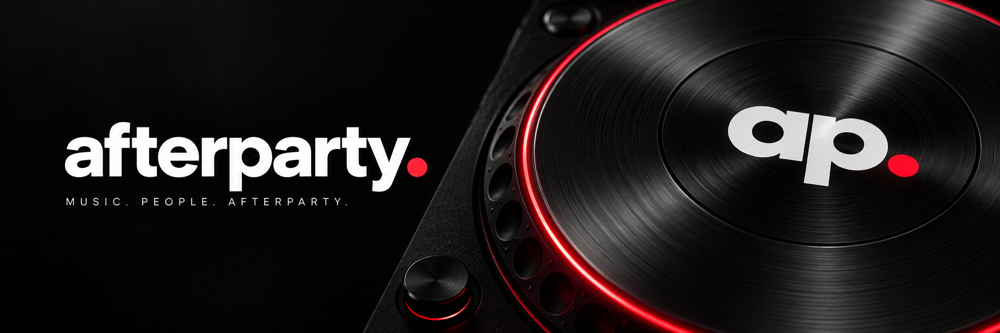
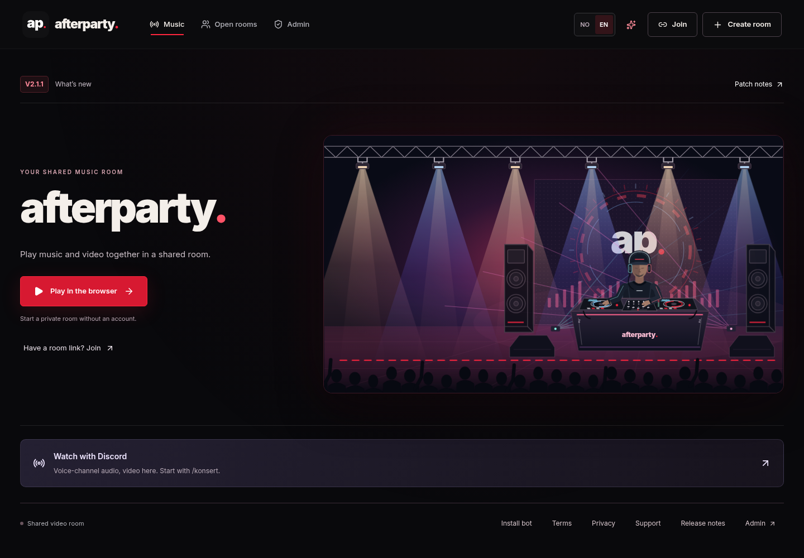
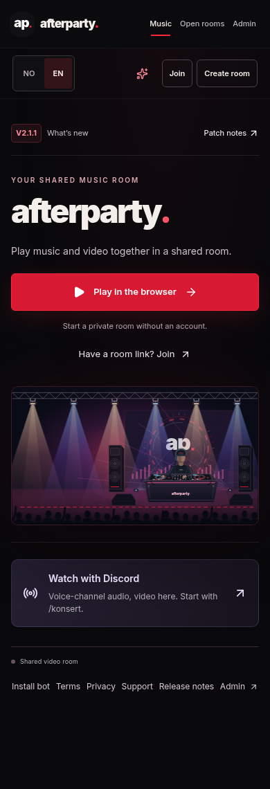
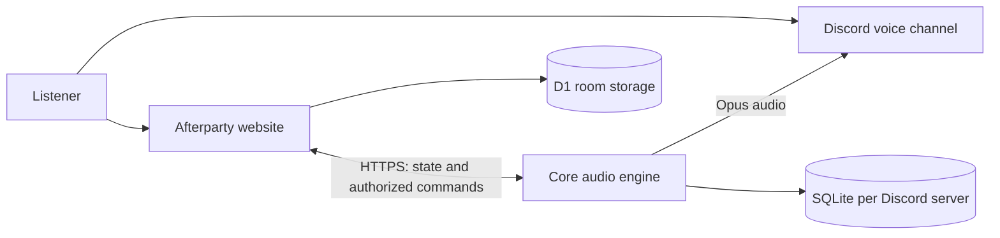

<div align="center">



# Music brings people together.

**A self-hosted Discord music bot. A shared video room. One place for the evening.**

[](https://github.com/lukasvri/Afterparty-MusicBot/actions/workflows/core.yml)
[](LICENSE)
[](https://nodejs.org/)

[**Open Afterparty**](https://afterparty.lukasvri.chatgpt.site) · [**Install your own**](docs/INSTALLATION.md) · [**Documentation**](docs/README.md) · [**Changelog**](CHANGELOG.md)

</div>

## The evening, your way

Play music in a Discord voice channel, share a concert with video, or open a private browser room without an account. Afterparty keeps the queue, controls and shared timeline together.

| Discord music | Shared concerts | Your own rooms |
| --- | --- | --- |
| Search or paste a link with `/play` | Use `/concert` for Discord audio and website video | Start a private room and invite friends with a link or QR code |
| Radio, favorites and saved queues | Requests, votes and moderated queues | Host controls, cohosts and ownership transfer |
| Pause, seek, skip and crossfade | Playback follows Core's audio clock | Save evenings locally, import/export and use TV mode |
| Separate settings and storage for each server | Ordinary Discord music stays private | Browser rooms work without a Discord connection |

YouTube video uses the official embedded player. SoundCloud provides audio; Spotify links are matched to a playable source. Provider availability and browser autoplay rules still apply.

## Built for the big screen. Ready for your pocket.

<a href="docs/assets/afterparty-desktop.png"></a>

<details>
<summary><strong>See the mobile view</strong></summary>
<br />


</details>

Screenshots show a local preview with synthetic API responses, in English. They illustrate the interface, not a connected production bot.

## Run your own Afterparty

The full stack has two services. **Core** runs on your computer or server and sends audio to Discord. The **website** runs on Cloudflare Workers/D1 or Sites and provides rooms, video and administration. Core's host must stay online for Discord playback.

| Service | What it needs | Start here |
| --- | --- | --- |
| Core | Docker with Compose v2, your Discord application and an HTTPS endpoint | [Installation](docs/INSTALLATION.md) · [Core guide](services/core/README.md) |
| Website | Node.js 24.17+, Workers/D1 or Sites hosting, your database and HTTPS origin | [Website setup](docs/INSTALLATION.md#5-build-and-preview-the-website) |
| Connection | A shared bridge secret and Discord OAuth configuration | [Configuration reference](docs/CONFIGURATION.md) |

There is no one-command production installer for both services. The installation guide covers configuration, database migrations, hosting and your first track.

### Fresh installation

```bash
git clone https://github.com/lukasvri/Afterparty-MusicBot.git
cd Afterparty-MusicBot
cp services/core/.env.example services/core/.env
cp .dev.vars.example .dev.vars
```

Fill in your own credentials and URLs using the [installation guide](docs/INSTALLATION.md). These copy commands are for a fresh clone; keep existing private configuration when updating.

After configuring and installing your Discord application:

```bash
cd services/core
docker compose up -d --build
curl --fail http://127.0.0.1:3990/health
```

`ready: true` confirms Discord readiness. Continue with [website setup](docs/INSTALLATION.md#5-build-and-preview-the-website) and the [first-track checklist](docs/INSTALLATION.md#8-play-your-first-track) to verify the complete system.

## One engine, separate spaces



Core owns Discord audio playback and its clock. The website displays that state and sends authorized commands. Each Discord server keeps its own queue, settings, favorites and database. Browser rooms have their own queues and permissions. See [architecture](docs/ARCHITECTURE.md) for the boundaries and transport.

## Keep the music running

Run these from `services/core/`:

| Task | Command |
| --- | --- |
| Start the existing image | `docker compose up -d --no-build` |
| Check containers | `docker compose ps` |
| Read recent logs | `docker compose logs --tail=100 core` |
| Stop Core | `docker compose stop core` |

Back up the complete `/data` volume, including `guilds/`, before an update. `docker compose down -v` deletes the data volume. [Operations and recovery](services/core/PUBLIC_RELEASE.md) covers safe updates; [host readiness](docs/HOST_READINESS.md) covers live backups, restore checks and health reports. [Remote deployment](docs/REMOTE_DEPLOY.md) keeps credentials and production data on the bot host.

## Work on the project

With Node.js 24.17+, Python 3.11+ and FFmpeg installed:

```bash
npm run setup:cloud
npm run check:all
```

This installs both locked dependency trees, runs deployment recovery, website and Core tests, checks both TypeScript projects, and builds the website. Audio tests use real FFmpeg with synthetic tones. Browser automation uses simulated playback and isolated fixtures. See [contributing](CONTRIBUTING.md) and the [cloud workflow](docs/CLOUD_DEVELOPMENT.md).

The validation command requires repository-wide lint with zero warnings. Automated checks do not establish live Discord audio quality or multi-server production capacity; the [release review](docs/RELEASE_REVIEW.md) records the remaining live checks.

## Rust audio research (experimental)

Afterparty's current Discord Core runs on **TypeScript/Node.js and FFmpeg**. We are exploring **Rust** for a small, isolated PCM audio-mixing component, with a focus on volume control, crossfades and measurable performance under load. A prototype is **not** a replacement for the existing audio engine, and it has no production or Discord connection.

TypeScript development, fixes and new application features continue on `main` through reviewed PRs. The separate [`dev` branch](https://github.com/lukasvri/Afterparty-MusicBot/tree/dev), initially created from the latest `main`, is for isolated Rust testing. Existing `nightly` and Rust experiment branches are preserved separately; they are not merged into `main` as part of this setup. Any future adoption of Rust in `main` requires a separate decision and review. See the [branch strategy](CONTRIBUTING.md#branch-strategy).

Rust testing continues with the [offline Rust mixer on `dev`](https://github.com/lukasvri/Afterparty-MusicBot/tree/dev/experiments/rust-audio) and its [development notes](https://github.com/lukasvri/Afterparty-MusicBot/blob/dev/docs/RUST_DEVELOPMENT.md), transferred from `nightly` with its tests and latest rounding fix. The [earlier experimental source](https://github.com/lukasvri/Afterparty-MusicBot/tree/experiment/rust-audio-nightly-20261016/experiments/rust-audio) remains preserved. Rust will not appear in the GitHub language chart for `main` until Rust source files are actually merged there.

## Explore further

| I want to… | Read |
| --- | --- |
| Install and configure the stack | [Installation](docs/INSTALLATION.md) · [Configuration](docs/CONFIGURATION.md) |
| Understand rooms and permissions | [Own rooms](docs/OWN_ROOMS.md) · [Party experience](docs/AFTERPARTY_EXPERIENCE.md) |
| Understand audio and synchronization | [Music sources](services/core/docs/music-sources.md) · [Concert stability](docs/CONCERT_STABILITY.md) |
| Prepare an update or release | [Operations](services/core/PUBLIC_RELEASE.md) · [Release policy](docs/RELEASING.md) |
| Use the visual identity | [Branding and assets](docs/BRANDING.md) |

New website sessions default to English and retain saved language choices. Discord uses a compact English slash menu; `/play` includes optional `next`, `now` and `shuffle` controls. Persistent bot settings live on the server-scoped administration page rather than `/config`. Compatibility handlers accept previously cached command invocations. Spotify matching can differ from the original recording; chapter splitting and SponsorBlock are not implemented. Independent clients have different buffering and network delays, so synchronization is approximate.

## Contribute, report, remix

[Open an issue](https://github.com/lukasvri/Afterparty-MusicBot/issues) for a reproducible problem, or read [CONTRIBUTING.md](CONTRIBUTING.md) before a pull request. Report vulnerabilities through [SECURITY.md](SECURITY.md). Keep tokens, private logs, server IDs and databases out of public reports.

Afterparty is released under the [MIT license](LICENSE). Retained upstream code and fonts keep their [third-party notices](THIRD_PARTY_NOTICES.md). The license does not grant rights to music, video or third-party artwork. Website and Core versions are recorded in their package manifests and the shared [changelog](CHANGELOG.md); a release entry does not prove production deployment.
