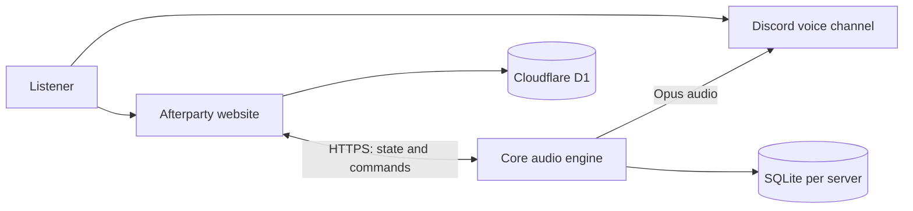

<div align="center">

# Gutta Krutt Afterparty

**Your Discord music bot. Your shared concert room. Your server.**

Play music in Discord, bring video into a shared room, and manage everything from one web interface.

[](https://github.com/lukasvri/gutta-krutt-afterparty/actions/workflows/core.yml)
[](LICENSE)
[](https://nodejs.org/)

[Installation guide](docs/INSTALLATION.md) · [Configuration](docs/CONFIGURATION.md) · [Operations](services/core/PUBLIC_RELEASE.md) · [Codex Cloud](docs/CODEX_CLOUD.md) · [Report an issue](https://github.com/lukasvri/gutta-krutt-afterparty/issues)

</div>

---

## What you can do

| In Discord | On the website |
| --- | --- |
| Play music with `/play` | Watch shared concert videos |
| Use radio, favorites and saved queues | Open rooms with host controls |
| Pause, seek, skip and crossfade tracks | Manage your Discord servers through `/admin` |
| Keep one player message instead of chat spam | Follow the Core playback clock |

Each Discord server has its own queue, settings and SQLite database. Ordinary `/play` music stays out of the public concert feed. Use `/konsert` when you want to share a concert.

## Before you install

This project has **two services**: a Docker-based audio engine and a Cloudflare Workers/D1 website. The audio engine runs on your computer or server and must stay online. The website is built with React and Vinext, with Sites integration included.

> **Hosting status:** Core has a ready-to-use Compose file. The website requires your own Workers/D1 or Sites deployment and an HTTPS connection to Core. There is no single-command production installer for the complete stack. Start with the guide below, which separates local preview from a full installation.

| You need | Used for |
| --- | --- |
| Git and Docker with Compose v2 | Downloading and running Core |
| Node.js 24.17+ and npm | Building and previewing the website |
| Your own Discord application and test server | Bot token, server installation and admin sign-in |
| A Workers/D1 or Sites hosting setup | The production website and room database |
| HTTPS addresses for the website and Core | Admin sign-in and communication between services |

Examples use Bash on Linux, macOS or Windows through WSL2.

## Get started

### 1. Download the project

```bash
git clone https://github.com/lukasvri/gutta-krutt-afterparty.git
cd gutta-krutt-afterparty
```

### 2. Create your configuration files

```bash
cp services/core/.env.example services/core/.env
cp .dev.vars.example .dev.vars
```

Fill them with **your own** credentials. The [installation guide](docs/INSTALLATION.md#2-create-and-install-your-discord-bot) shows where to find each value. The same bridge secret goes into Core's `PUBLIC_SITE_ADMIN_KEY` and the website's `ADMIN_BRIDGE_KEY`.

### 3. Build and start Core

After completing the Discord and URL setup in the guide:

```bash
cd services/core
docker compose up -d --build
curl --fail http://127.0.0.1:3990/health
```

Expected response:

```json
{"ready":true,"engine":"gutta-krutt-core"}
```

This confirms the bot is connected to Discord. It does not verify the website or audio playback yet.

### 4. Set up the website and play your first track

Follow [the website setup steps](docs/INSTALLATION.md#5-build-and-preview-the-website), then the [first-use checklist](docs/INSTALLATION.md#8-play-your-first-track). The guide covers database setup, HTTPS, Discord login and common errors.

**[Open the complete step-by-step guide →](docs/INSTALLATION.md)**

## How it fits together



Core owns audio playback and the shared timeline. The website displays state and sends authorized commands. FFmpeg handles decoding and Opus encoding; SQLite preserves queues, settings and recovery information.

## Everyday commands

Run these from `services/core/`:

| Task | Command |
| --- | --- |
| Start an already-built bot | `docker compose up -d --no-build` |
| See container status | `docker compose ps` |
| Read recent logs | `docker compose logs --tail=100 core` |
| Stop without deleting data | `docker compose stop` |

Data is stored in the `core-data` Docker volume. Back up the entire volume, including `guilds/`. See [updates and backups](services/core/PUBLIC_RELEASE.md) before upgrading. `docker compose down -v` deletes the volume.

## Development and checks

To update an existing bot privately from another computer, see
[Remote deployment with deploy-core](docs/REMOTE_DEPLOY.md). Tests and backups
run on the bot host; production credentials and data stay there.

From the repository root:

```bash
npm run setup:cloud
npm run check:all
```

These commands need Node.js 24.17+, Python 3.11+ and FFmpeg. They install both locked dependency trees and run **60 Core tests**, **29 website behavior tests**, deployment recovery tests, both typechecks and a website production build without production credentials or Docker. GitHub Actions validates Core's Docker image, the website and deployment recovery on pushes and pull requests. See the [Codex Cloud workflow](docs/CODEX_CLOUD.md) for cloud setup and local production updates.

<details>
<summary><strong>Repository map</strong></summary>

```text
app/                 Website pages and API routes
components/, hooks/  Player UI and browser behavior
lib/                 Website state, authorization and Core transport
db/, drizzle/        D1 schema and migrations
services/core/       Discord bot, audio engine, Compose and tests
build/               Sites and Cloudflare integration
scripts/             Development commands and browser behavior tests
docs/                Installation and configuration guides
```

</details>

## Current limitations

- Website deployment needs your own hosting configuration; local preview is not a deployed service.
- Some application messages and slash commands are Norwegian. The installation documentation is in English.
- Spotify links are matched to playable audio sources. SoundCloud plays as audio; YouTube video uses the official embedded player.
- Chapter splitting and SponsorBlock are not implemented.
- Separate clients have their own buffers and network delays; perfect synchronization is not guaranteed.
- Concurrent load across multiple real Discord servers has not been established by a production load test.

## Contributing and security

Read [CONTRIBUTING.md](CONTRIBUTING.md) before opening a pull request. For credential exposure or vulnerabilities, follow [SECURITY.md](SECURITY.md). Never include tokens, `.env` files, private logs or databases in an issue.

## License

Released under the [MIT license](LICENSE). Third-party code keeps its own notices; see [THIRD_PARTY_NOTICES.md](THIRD_PARTY_NOTICES.md). The software license does not grant rights to music, video or third-party artwork.
