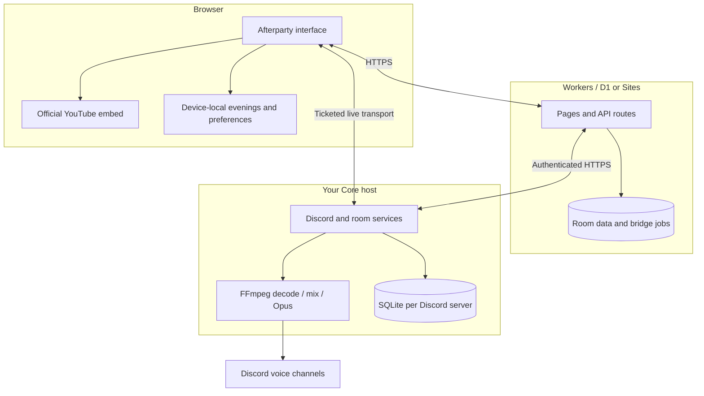

# How Afterparty fits together

[Documentation](README.md) · [Installation](INSTALLATION.md) · [Configuration](CONFIGURATION.md)

Afterparty has a self-hosted Core service and a website. The services share state through an authenticated HTTPS connection; they do not share a database file.

## Source map

Start with the responsibility below rather than reading every file. There are two website implementations during the migration: Classic remains the operational baseline and explicit rollback; `apps/web` is the v3 candidate. Both use the existing API handlers and shared domain rules. A second UI does not imply a second database or a second Core.

| Responsibility | Canonical location | Entry point |
| --- | --- | --- |
| Classic pages and interface | `app/`, `components/`, `hooks/` | `app/page.tsx`, `app/admin/admin.tsx` |
| v3 routes and page composition | `apps/web/src/routes/` | `v3/+page.svelte`, `games/+page.svelte` |
| v3 feature implementations | `apps/web/src/lib/` | Feature folders below |
| Shared website API handlers | `app/api/` | `route.ts` adapters into `lib/` |
| Website room persistence and catalog | `lib/` | `server.ts`, `concert-catalog.ts` |
| Website auth and scoped Core proxy | `lib/` | `discord-auth.ts`, `admin-session.ts`, `core-server.ts` |
| Shared browser storage and playback rules | `lib/` | `browser-storage.ts`, `live-room.ts`, `playback-sync.ts` |
| Shared bot settings, bounds and UI fields | `services/core/src/settings.ts` | Imported by Core, Classic and v3 |
| Shared social messages and validation | `services/core/src/social-protocol.ts` | Browser-safe; no database, token signing or Node imports |
| Device-local reaction expiry | `lib/social-reactions.ts` | Shared by both website implementations |
| Discord/Core startup | `services/core/src/` | `main.ts`, `guilds.ts`, `server.ts` |
| Playback and source extraction | `services/core/src/` | `engine.ts`, `audio.ts`, `providers.ts`, `extractor.ts` |
| Core rooms, games and social authority | `services/core/src/` | `rooms.ts`, `guess-game.ts`, `social.ts` |
| Website schema and migrations | `db/`, `drizzle/` | Existing D1 migration sequence |
| Core schema and data | `services/core/src/` | `store.ts`, `migrate.ts`; private data stays outside Git |
| Local checks, builds and browser fixtures | `scripts/`, `apps/web/scripts/`, `apps/web/tests/`, `services/core/tests/` | `npm run check:all` plus browser suites |
| Host update and recovery | `operations/`, `services/core/` | [Operations](../services/core/PUBLIC_RELEASE.md) |

The v3 feature folders keep each component beside its client and behavior helpers:

| Folder in `apps/web/src/lib/` | Contents |
| --- | --- |
| `rooms/` | Room discovery, lifecycle, queue client and synchronized browser player |
| `concert/` | Public Discord concert client and shared-clock audio adapter |
| `games/` | Guess the Song client, presets, ranking and game audio |
| `library/` | Favorites/evenings, playlist import and festival catalog |
| `social/` | Reactions, moments and host bingo |
| `admin/` | Server-scoped administration client |
| `server/` | Native API dispatch and fixed service-binding bridge |
| `ui/` | Shared icons, public-page frame and copyright form |

Routes compose these features and import individual modules. The optional library stays behind its dynamic import. Avoid an all-features barrel that would eagerly load unrelated code. Tests import the same canonical modules from the feature folders.

Shared contracts belong in browser-safe modules; authorization and persistence remain in their server implementations. Reuse contracts and pure rules across Classic and v3 without forcing different UI lifecycles into a single controller. Keep the 26 existing API route adapters so URLs, authorization and rollback continue using the same handlers.

## Discord playback

`services/core/src/main.ts` connects the Discord bot, creates the guild registry, starts the HTTP services and runs the website bridge. Each guild has an engine, commands and store. The initial owner server uses `/data/core.sqlite`; additional servers use `/data/guilds/<server-id>/core.sqlite`.

Providers resolve playable sources and metadata. FFmpeg decodes, mixes and encodes audio for Discord. The engine owns the playback timeline, queue revisions, recovery and radio decisions. A shared extraction gate bounds concurrent media processes and prioritizes audio startup.

[Radio 2.0](RADIO.md) uses one platform-neutral selection pipeline for Discord providers, browser rooms and the website fallback. Optional catalog and bounded search adapters supply candidates; shared policy checks content, recording identity, style, exclusions and playback capabilities before ranking them. The engine and room handlers retain final generation/revision checks and own all playback and persistence changes.

Ordinary `/play` tracks are private Discord music. `/concert` exposes concert state to the website; the compatibility handler also accepts cached `/konsert` invocations. Public concert operations do not gain access to a guild's private tracks, requester information or administration.

## Browser rooms

The website stores browser room data in D1. Core's room service supplies live room updates and progression; the website includes fallback room handling when that transport is unavailable. Browser rooms have their own queues, revisions, host tokens and permissions. They do not share Discord guild history.

Each browser plays video through the official YouTube embed and applies the shared timeline. Buffering, autoplay and network delay still differ between devices. Local volume, synchronization preferences, diagnostics and saved evenings stay on the device. See [own rooms](OWN_ROOMS.md) for the exact behavior and recovery boundaries.

## Commands and live state

Browser APIs and hooks live in `app/api/`, `lib/` and `hooks/`. The website authorizes commands before forwarding them to Core. Direct live transport uses short-lived tickets. WebSocket and continuous HTTP updates carry live state; polling and queued bridge jobs provide fallback paths.

Queue revisions reject stale edits. Clock sampling accounts for transport delay, while each client compensates for its own buffering. The website displays playback state; it does not independently advance Discord audio.

## Access and secrets

Core and the website use a shared bridge secret. Discord OAuth supplies administrative identity and server permissions. Ownership, Administrator or Manage Server permission is checked for the selected guild; legacy owner access does not grant another guild's administration.

Bot tokens, OAuth client secrets, environment files and deployment-specific hosting settings stay private on the host or hosting platform. The repository contains templates only. See [configuration](CONFIGURATION.md) and [security](../SECURITY.md).

## Build and operations

The website uses React, Vinext, Vite and Cloudflare Workers/D1 with Sites integration. Core uses Node.js, Discord libraries, SQLite, FFmpeg and yt-dlp. Compose runs Core separately from the website. A website deployment does not keep an offline Core host available.

`npm run check:all` validates isolated application and recovery behavior and builds the website. Production listening, source availability, reconnect behavior and simultaneous real voice capacity require host validation. [Host readiness](HOST_READINESS.md) and [operations](../services/core/PUBLIC_RELEASE.md) cover backups and reviewed updates.
