# Radio 2.0: discovery, selection and the original song

[Documentation](README.md) · [Own rooms](OWN_ROOMS.md) · [Music sources](../services/core/docs/music-sources.md)

Radio follows the most recent explicit song choice that becomes current. An automatically recommended song does not replace that original. This prevents a chain of individually related recommendations from gradually changing the station's direction.

## Radio 2.0 selection architecture

Discord providers and browser-room selection now use one platform-neutral TypeScript pipeline. The website's D1 fallback imports the same room adapter. Transport, persistence, playback clocks, queue revisions and generation checks remain outside the selector.

```mermaid
flowchart LR
    Original[Original manual song and private exclusions] --> Metadata[Validate or refine recording metadata]
    Metadata --> Discovery[Bounded catalog and search adapters]
    Discovery --> Admission[Content, style, recording and capability checks]
    Admission --> Ranking[Compare eligible pools and artist diversity]
    Ranking --> Result[One candidate and sanitized diagnostics]
    Result --> Owner[Existing engine or room revision checks]
```

The selector treats the supplied lookup context as read-only and builds a fresh selection context for each call. It filters known seed/history/rejected catalog recordings before spending playback-matching slots, gathers bounded candidate pools and ranks eligible choices together. Artist diversity takes precedence over a favorite among otherwise suitable choices; favorites still break comparable choices. A provider's first match does not automatically win. Candidate relationship evidence is checked per candidate and tied to the original seed, never granted to an entire search pool because one catalog track was related.

Last.fm's [track.getSimilar](https://www.last.fm/api/show/track.getSimilar) supplies listening-based track relationships. Its [artist.getTopTracks](https://www.last.fm/api/show/artist.getTopTracks) supplies popular tracks by the original artist as a bounded fallback. Artist popularity does not establish a relationship to an unrelated artist. Catalog matching must still identify the actual recording, and every playback result passes the same content, style, history and visibility checks. Last.fm remains optional; adapters without a configured catalog use the shared safe search stages instead. No new provider account is required.

Successful nonempty recommendation results retain the 24-hour cache lifetime. Successful empty results expire after 60 seconds so later retries can recover. Errors are not recorded as successful empty results. Versioned cache keys prevent older data from bypassing the updated parser and policy.

The fixed limits per selection are one metadata-refinement search inspecting at most 12 results, at most 15 descriptors per catalog source, four catalog hydration attempts in total with at most three spent on similar tracks, and two discovery searches inspecting at most 20 results each. At least one hydration slot remains available for original-artist recovery when needed; it can also use slots the similar-track stage did not spend. At most 60 playback candidates are admitted to inspection. These count adapter calls and candidates, not every lower-level HTTP or extractor operation inside an adapter. Search hydration stays sequential so different queries can reuse completed video metadata instead of racing duplicate requests.

### Decision and trade-offs

The previous separate selectors differed in fallback coverage, and the catalog path spent its first matching slots on recordings already in history. Keeping both orchestration paths would retain that inconsistency. Adding a separate recommendation service would introduce another operational dependency without removing playback matching or exclusion requirements. The shared selector reuses existing providers and makes candidate provenance, budgets and rejection reasons testable in one place.

Comparing multiple pools may use more provider work than returning the first acceptable upload. Fixed candidate and lookup budgets limit that cost; existing provider timeouts and shared-search coalescing remain in force. The selection budget is not a promise about end-to-end provider latency. Missing metadata can still leave no safe candidate, and synthetic acceptance fixtures do not establish personal taste, live provider coverage or audible Discord quality.

The candidate universe is still finite. Existing positive search/catalog caches can become exhausted by a long station history. This rebuild does not promise unlimited discovery or bypass provider quotas by repeatedly refreshing every rejected pool. Adaptive replenishment needs an isolated reproduction and request-cost measurements before changing that cache behavior.

## Seed lifecycle

Discord Core stores the original track in the server's private SQLite state. Browser rooms store it in their private room JSON. Both survive service restart. Queueing a manual song leaves the current original intact until the queued song becomes current; a direct play selection changes it immediately. Pausing, seeking or toggling radio does not change the original. An explicit Core stop clears it.

The current song and recent history are still excluded from selection, even when they differ from the original. Normal Discord music and concerts preserve their visibility boundaries. The original seed is not added to public room snapshots.

Older browser rooms can recover the last explicitly marked manual song from history. When an older installation has no original seed or identifiable manual history, the earlier choice cannot be reconstructed reliably. Choose the intended starting song once after updating; subsequent automatic tracks retain that choice.

## Similarity evidence

- A specific genre such as electro house or progressive house can support recommendations across artists. Conflicting explicit styles are rejected.
- A broad tag such as pop, rock or house does not establish that another artist belongs in the station. Without specific metadata or a vetted recording relationship, selection stays with the original artist.
- Browser rooms can refine a missing or broad House genre from another upload of the same recording. Artist, song identity, version labels and duration must agree. A tutorial, cover, conflicting style or alternate instrumental cannot supply that metadata. The accepted recommendation retains private proof tied to the original video ID, so reloading or advancing a prepared queue does not discard the learned relationship. That proof is removed from public snapshots.
- Core can use Last.fm's similarity to the original song. Missing, malformed or weaker-than-0.2 similarity scores are discarded. The score is provider evidence, not a measured audio similarity guarantee. Matched playback videos still pass content, style, history and visibility checks.

An uploader label, including `Official`, `Topic` or `VEVO`, cannot override a different artist in an explicit `Artist - Song` title. A specific Topic or VEVO channel can supply the artist when the title contains only the song or a recognized recording suffix such as `2024 Remaster`. Shared publishers such as NCS and Various Artists are not artist evidence. Unknown upload channels need an explicit artist title, specific genre or validated catalog relationship. Ambiguous title separators remain a metadata limitation. Old unfiltered Last.fm cache entries are not reused by the updated selection policy.

## Music filtering

Automatic candidates must be finite, non-live songs between 90 and 600 seconds. YouTube video metadata and the yt-dlp fallback retain explicit music-category evidence. A known non-music category excludes automatic selection, including on the website fallback; absent category metadata remains unknown and can use the other evidence above. Search and metadata cache versions prevent older results from bypassing this check. Manual playback remains available for non-music videos.

Searches, metadata learning, catalog matches and prepared radio entries reject instructional and non-song titles, including tutorials, procedural how-to phrases, production lessons, DAW projects, step-by-step videos, reactions, interviews, vlogs, gameplay, covers, remakes and long sets. Filtering uses the song portion after a recognized artist prefix, so an artist name such as The Trailer Park Troubadours is not mistaken for a trailer. Real song names such as Music and How To Love remain usable, including Topic uploads.

Older queued automatic entries are checked again before playback or crossfade preparation. Manual selections are preserved. Title and metadata filtering is conservative and can reject a valid upload; incomplete or misleading provider metadata can still affect selection. When no safe candidate is found, existing cooldown, retry and playback-preservation rules apply instead of choosing an unrelated result.

Browser rooms try a specific genre search first and fall back to the original artist when known. Both searches retain the same content, style and recording exclusions. A host can explicitly retry radio while the current song is playing: an eligible result prepares the next song without restarting the current playback clock. An empty retry reports an actionable error and retains the current song, with a 15-second cooldown before another automatic attempt. Explicit retries remain available during that cooldown. Both Core and the website fallback retain revision checks, so a late result cannot replace a newer manual queue or radio-off command.

Room recommendation logs contain a sanitized `room-radio` diagnostic: selected, empty, filtered, provider-error or insufficient-metadata; the recognized seed genre; whether an artist was identified; metadata-refinement status; and search/candidate counts. They contain no room identifiers, song titles, queries, credentials or provider error text. An empty provider response differs from candidates rejected by policy and from all recommendation searches failing. Metadata-refinement failures are recorded separately and retain conservative artist matching. Cached provider data still follows the existing metadata cache versions and is revalidated by the same selection policy.

## Repeats, rejection and explicit replay

Radio compares recording names as well as video IDs. Normalization recognizes alternate uploads, remasters, radio edits, instrumentals and remix labels. Named remixes without brackets are compared against known originals; this is a conservative metadata rule, not an audio fingerprint. Candidates are ranked before duplicate uploads are collapsed, allowing the better official upload to win.

Core checks its last 100 public playback records and retains a bounded private history of canonical catalog metadata. Public history continues to omit catalog, requester and recommendation-proof fields. This prevents a matched song from reappearing merely because its YouTube title differs from its catalog title. Browser rooms check current playback, history, removed suggestions and earlier prepared queue entries. A paused song is still current and is excluded even before audible playback is recorded.

Core also supplies the active track directly to selection before its first consumed segment is recorded. This matters when an automatic song differs from the original manual seed: an alternate upload of that active recording must be removed before choosing a winner, so it cannot hide another eligible song and then fail only at the engine's final guard.

Skipping an early automatic song or removing a prepared suggestion records both its ID and song metadata. Core exclusions last seven days and are capped at 200 entries per server; room exclusions are bounded by the room's private state. Clearing or removing a suggestion permits a new lookup instead of retaining the previous successful lookup's infinite retry delay. Undo lifts the restored suggestion's removal exclusion while retaining unrelated exclusions.

These exclusions apply to new automatic choices. Manual requests, explicit unskip and saved-queue replay, and queue looping preserve the user's replay intent. A checkpoint can resume the exact previously active entry despite its presence in history. Numbered skips retain their requested target when an unsafe older suggestion is removed from the queue. Normal Discord queues, public concerts and other servers retain their existing separation.

## Validation

The radio suites cover original-seed drift, broad-pop mismatch, instructional candidates, category loss on provider fallback, alternate recordings, private catalog identity after restart, weak and unsafe Last.fm matches, uploader ambiguity, learned genre persistence, current and historical duplicates, skip/remove/undo, explicit replay and exact checkpoint recovery. The D1 suite exercises the actual website fallback and refresh of older search metadata. Existing stale-revision, late-result, manual-queue, voice isolation and real FFmpeg suites remain part of `npm run check:all`. Check the current PR and CI runs for the result on a specific commit; older test counts are not evidence of current deployment.

Tests use synthetic metadata, providers, databases and audio. They do not certify live provider availability or musical similarity for every recording. Follow [operations](../services/core/PUBLIC_RELEASE.md) to update both Core and the website together, then verify the intended station on the deployment host before release.
