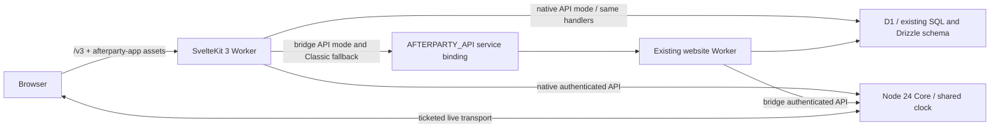

# Afterparty 3 SvelteKit candidate

The `3.0.0-alpha.1` candidate in `apps/web/` implements the native Svelte website for
[issue #114](https://github.com/lukasvri/Afterparty-MusicBot/issues/114). It is
review material, not evidence of production deployment or stable 3.0 acceptance.
The existing website and Node 24 Core remain the operational rollback baseline.

## Candidate scope

The source scope for `3.0.0-alpha.1` is the native website and existing
non-Activity Core integration described below. Embedded Discord Activity stays
on its separate beta line; it is not a prerequisite for this alpha candidate.
Node 26 qualification is independent of the website migration, and Node 24
remains the Core release baseline. No Rust adoption or database rewrite is part
of this scope.

The native interface uses English while retaining existing local library,
ownership and language preferences. Classic remains the explicit rollback and
provides its existing translated interface when its service binding is present.
This is a defined alpha candidate, not a claim of full translated parity,
licensed real-song availability, stable 3.0 acceptance or approval to launch.
The remaining catalog, real-device listening and live-release gates stay in
[issue #92](https://github.com/lukasvri/Afterparty-MusicBot/issues/92) and
[issue #37](https://github.com/lukasvri/Afterparty-MusicBot/issues/37).

## Implemented journeys

- Private/public browser rooms, open-room discovery and invitation links.
- Shared search, queue editing, votes, guest request approval, radio, host/cohost
  controls, ownership transfer/revocation and persisted browser ownership.
- YouTube playback after explicit consent, local volume/mute preferences and
  fullscreen, with the shared server clock and stale-command protection.
- Existing saved evenings/favorites, library backup/import, YouTube/Spotify
  playlist preview and selection, and curated festival sets by event/year.
- Discord public concert view with explicit server selection, command receipts,
  voting, authorized queue moderation and consent-based browser audio from a
  calibrated, leased Core stream. Ordinary Discord music stays private.
- Native administration with OAuth/password session gates, selected-server
  settings, queue/player controls, channels, timers, saved queues and diagnostics.
- Opt-in reactions, timestamped shared moments and host bingo with existing Core grants.
- Native Guess the Song game-night hosting/invites, recording-aware presets,
  one-step save/start, focused rounds/reveals, tie-aware standings and optional
  audio continuity across rounds. Local game volume is separate from music
  volume. Scoped grants, scoring, hints and game rules remain server-owned.
- Native install, support, privacy, terms, copyright and patch-note routes. The
  copyright notice remains device-only until the user chooses an external action.

The interface uses the canonical vector logo, self-hosted Inter font, black/red
surfaces, keyboard focus, touch targets and reduced-motion support. Desktop and
mobile use the same native component trees. Existing local libraries, room tokens,
preferences, database tables and Core identifiers retain their storage formats.
The native UI currently uses English. Saved Classic language choices are retained
in storage and Classic remains available when an API service binding is configured.

## Architecture and compatibility



The locked candidate uses SvelteKit 3.1.0, Svelte 5.57.2, TypeScript 6.0.3,
Vite 8.3.5, adapter-cloudflare 8.0.1 and Wrangler 4.118.0. Their declared peer
ranges are compatible. TypeScript 7 is available but outside Kit's TypeScript 6
peer range. The existing website/Core TypeScript and Node 24 runtime are retained.
The candidate also retains the root project's patched Sharp and Undici overrides
for Wrangler/Miniflare's local development dependencies.
Kit 3 configuration lives in the Vite plugin, uses `#lib` package imports and
`$app/tsconfig`, and accesses bindings through `cloudflare:workers`.

Two API modes use the same existing framework-independent request handlers:

- **Bridge mode** (default) forwards API requests through `AFTERPARTY_API`.
- **Native mode** (`AFTERPARTY_NATIVE_API=1`) dispatches the existing `app/api/`
  handlers inside the Svelte Worker against its own existing D1/Core bindings.
  The Svelte build resolves these shared server modules without a React/Vinext
  runtime. The fixed adapter preserves requests, cookies, redirects, streams,
  origin checks and dynamic room parameters. Unsupported methods fail with 405.

`apps/web/wrangler.standalone.jsonc` is an isolated local template for native
mode. Its database ID is synthetic. Production adoption requires binding the
existing intended database and required runtime variables/secrets after review;
no database copy, import or schema rewrite is part of this frontend migration.
Do not use the local template's database identity for production. Native mode
must receive all existing configuration previously supplied to the API Worker,
including any copyright operator contact override.

The catch-all retains the fixed service binding for legacy routes. An explicit
`?classic=1` bypass preserves the original page when that binding exists. Missing
bindings fail closed; no browser-controlled upstream URL or new authentication
namespace is introduced. OAuth callbacks retain the public request URL, Origin,
HttpOnly cookies and authorization headers.

Browser storage reuses the existing lazy preference/ownership migration helper.
Room mutations include the latest version and existing visitor/host headers.
Commands are serialized; a conflict refreshes state without replaying the command.
Late responses cannot cross a room switch or overwrite a newer timeline.
Read failures stop local audio; reconnecting only reads current intent and cannot
send recovery play/skip commands. Polling uses the existing shared playback helpers.
Search and radio-dependent next retain the existing 35-second catalog budget;
editing a query immediately cancels and retires its previous request.
Server/Core progression owns automatic next; delayed browser end events never
advance the shared queue. The private browser-room client rejects Discord room
identifiers; public Discord concerts use their dedicated, server-scoped client.

Frontend adoption does not require a schema, queue, authentication, persisted
identifier or Discord-isolation migration. Both API modes reuse the same
D1/Drizzle handlers against the intended existing bindings. The built adapter
proves the Worker target; local stack tests verify both the service binding and
native packaged API against real isolated D1 storage. Bridge checkpoint/presence
changes have their own compatibility and rollback contract in
[the D1 write guide](D1_WRITE_BUDGET.md). Provider credentials and live Discord
are excluded from these local tests.

## Run locally

Use a clean cloud checkout with no production `.dev.vars`, credentials or data.
Node 24.17+, Python 3.11+ and FFmpeg are required for the whole repository.

```bash
npm run setup:cloud
npm run build
```

In a separate terminal, start only the website API with local synthetic storage:

```bash
XDG_CONFIG_HOME="$PWD/.sites-runtime/config" npm run start -- --name afterparty-api-local
```

Build and run the SvelteKit Worker in another terminal:

```bash
npm run build:web
npm --prefix apps/web run preview
```

Open `http://127.0.0.1:5174/v3`. The service binding discovers the API on port
8787 through the shared project-local registry. All Wrangler commands above are
local. For HMR, use `npm run dev:web`; its loopback API proxy preserves the public
Host/Origin relationship. Unported pages should be tested through the Worker
preview rather than the HMR server. Restart previews after rebuilding output.

## Standalone local API

After building, `npm --prefix apps/web run preview:standalone` runs the native API
with the synthetic local D1 template. Apply the existing `drizzle/` migrations to
that isolated local database using Wrangler's `--local` flag before testing rooms.
Do not copy production variables or data into this workspace. This local template
has no service binding, so the optional Classic fallback is unavailable.

The stack test runs both bridge and native API modes with fresh synthetic data.
In native mode it loads the separately bundled review artifact, verifies Classic
once, stops the legacy API Worker, then runs
all remaining API and browser assertions against Svelte and its direct D1 binding.

## Validation

```bash
npm run check:all
npm --prefix apps/web run format:check
CHROMIUM_PATH=/usr/bin/chromium npm --prefix apps/web run test:browser
npm --prefix apps/web run package:preview
CHROMIUM_PATH=/usr/bin/chromium npm --prefix apps/web run test:stack
```

`test:stack` requires both production builds but starts its own local Workers on
port 5175. It also verifies the beta root redirect and Classic bypass. It applies
existing migrations and seeds fictional metadata into a fresh temporary D1
directory for every run, then exercises the actual API and
mobile UI without routing API responses in Playwright. It tests persistence,
wrong-room host tokens, guest restrictions, cross-origin rejection, stale revisions,
search and transport, and shuts down its own Workers and removes temporary data.
No remote D1 flags or provider keys are used. Without `CHROMIUM_PATH`, Playwright uses its installed
Chromium; CI installs the matching browser and runs the synthetic UI suite.

The normal full check now includes candidate type/a11y checks, Node contract tests
and the Cloudflare build. The existing Node 26 website CI job additionally checks
formatting, desktop/mobile journeys and the isolated D1 stack test. Each application
retains its own locked Wrangler version during local integration. The signed release packaging remains
unchanged and contains the existing website only. No deployment steps were added.

See [screenshots and measurement provenance](assets/README.md). The candidate is
smaller in feature scope than Classic; payload observations must not be presented
as full-application performance parity. No audible Discord, live provider,
production OAuth, Lighthouse or field performance verification is claimed.

The recorded room/search payload observation from `768e6747` (before beta landing
configuration) is identical at 1440px and 390px:

| Successful local script responses | Classic | Svelte candidate |
| --- | ---: | ---: |
| Requests | 23 | 10 |
| Uncompressed bytes | 773,392 | 111,763 |
| Sum of individually gzipped bytes | 235,630 | 43,586 |

That historical slice served fewer features. These numbers describe the scoped
first slice only, not this expanded candidate or a measured whole-product speedup.

Local validation ran on Node 24.19.0, with an additional successful candidate
typecheck and Cloudflare production build on Node 26.12.1. Core was tested only
on Node 24 and its runtime configuration was not changed.

## Acceptance and rollout boundary

Browser rooms now subscribe to Core SSE when an authenticated read establishes
its epoch. The client samples the existing clock, validates leased timelines,
preserves authenticated roles and uses authoritative polling for metadata and
fallback. Epoch changes require a new authenticated read. Invalid, late and
retired frames cannot alter a newer room or replay a command. D1-only operation
continues with one-second polling. Actual browser EventSource coverage uses a
local synthetic HTTP/SSE fixture; live deployed transport is a separate check.

Core is retained on Node 24 with its existing clocks, persistence, isolation and
protocol. No alternate Core language/runtime or paused Rust work is introduced.
Its synthetic and real FFmpeg suite verifies implementation contracts, not what
someone hears in a Discord voice channel.

The native concert page plays public concerts from an authoritative Core stream
after explicit audio consent. Bridge polling cannot activate browser audio, and
ordinary Discord music is never exposed. Adding Discord music uses the bot or
administration. Native translated copy remains a gap; existing saved language
choices remain in storage and available through Classic during review. Do not describe this candidate as full feature
parity or a stable 3.0 release while those gaps remain.

Live YouTube/source availability, production OAuth cookies/callbacks, actual
Discord audio and owner acceptance still require authorized validation outside
cloud tests. A frontend port alone does not establish a provider/radio bug fix.

The existing isolated beta has a [deployment runbook](SVELTEKIT_BETA.md).
The beta-only entry flag selects `/v3` at the root. These templates prepare a
reviewable build and do not establish live availability. CI preserves a separate `v3-review-website` artifact with the tested bundled
Worker and assets. `npm --prefix apps/web run package:preview` bundles an already
built candidate with Wrangler `--dry-run`; it never publishes. The signed automatic
release artifact remains the existing operational website; the candidate is not
silently promoted by CI.

A production rollout requires reviewed feature/acceptance gates and explicit
owner approval. A frontend rollback restores the previous website artifact and
routing. D1 and Core require no schema rollback. Never delete databases or room
ownership storage. This cloud task does not merge, publish, deploy or change
production configuration.
