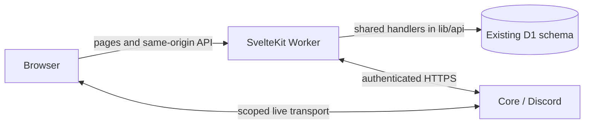

# Native website and v3 cutover

The owner has retired Classic. `apps/web/` is the sole website implementation,
using SvelteKit 3, Svelte 5 and TypeScript 6. Root commands build and package this
website. React, Next, Vinext, the Classic interface and its service-binding
fallback have been removed. This source change does not establish production
installation, live audio acceptance or a stable release.

## Routes and API ownership

- `/` is the listening room; `/discord` is the public concert interface.
- `/games`, `/admin`, `/install`, `/support`, `/patch-notes`, `/privacy`, `/terms`
  and `/copyright` are native routes.
- Existing Discord concert room links resolve their exact mapped guild before
  redirecting; an unknown secondary-server code never falls back to another
  server. New bot messages use explicit native guild links.
- Existing `/v3` and `/v3/discord` bookmarks redirect to the canonical native
  routes with their query parameters. `classic=1` cannot select another frontend.
- All 26 existing API handlers live in `lib/api/`. The native dispatcher retains
  their URLs, HTTP methods, CSRF, OAuth, password sessions and guild/room guards.
- One Worker accesses D1 directly. There is no API service binding or native-mode
  feature flag. A retired-host transition still blocks access before dispatch.



## Functional migration

| Capability | Native owner and preserved behavior |
| --- | --- |
| Listening rooms | `rooms/`: creation, discovery, joining, shared queue, votes, host/cohost controls, ownership transfer, guest approval and radio |
| Playback | `RoomAudio.svelte`: automatic local startup in music rooms, explicit activation in public concerts, browser-blocked sound recovery, shared clock, local volume/mute, keyboard controls, native/Safari fullscreen, viewport fallback and saved motion preferences |
| Sharing and TV | `RoomSharing.svelte`: locally generated public QR/link with no host credential; TV view retains the player and provides an explicit exit |
| Recovery | Room/concert clients retain epoch/revision/lease handling; game reconnect can explicitly rejoin after lost Core membership without replaying a command |
| Saved music | `library/`: existing favorites/evenings, local backup/import, bounded playlist previews and festival catalog |
| Public concerts | `concert/`: server selection, protected seek, search/library/playlist additions and calibrated browser audio; ordinary Discord music remains private |
| Administration | `admin/`: current OAuth/password authority, scoped server settings, channels, timers, saved queues, player and diagnostics |
| Games | `games/`: hosting/invites, capacity-aware presets, private guesses/media, skip votes, scoring, hints/reveals/results and independent local game volume |
| Social | `social/`: authorized reactions, shared moments and host bingo |
| Information | Native support/install/policy/copyright/patch-note pages retain their links and release history |

Storage keys, room tokens, server identities, media privacy and database tables
are retained. The native interface currently uses English; existing stored
language preferences are preserved. Core remains TypeScript with discord.js and
FFmpeg. The source Docker target is the qualified, immutable Node 26.12.1 image;
Node 26 is still Current in the latest verified release index, so actual LTS
confirmation and approved host promotion remain tracked in issue #117.

## Core authority and checkpoints

Core owns transient concert playback in negotiated authority mode. The Worker reads fresh scoped presence within a bounded deadline and retains durable intent/checkpoints for recovery. A failed authority read keeps checkpoint playback offline; it never resumes stale playback. D1-only operation and an explicit legacy compatibility override retain their tested paths. See [D1 write budget and authority](D1_WRITE_BUDGET.md) for negotiation, ownership and upgrade behavior.

## Build and isolated validation

```sh
npm run setup:cloud
npm run check:all
npm run start
```

The full check validates recovery, API/domain rules, Core/real FFmpeg, native
components and the native production build. `npm run test:browser` exercises
native desktop/mobile journeys; `npm run test:stack` uses the exact packaged
Worker with temporary migrated D1. `npm --prefix apps/web run measure:startup`
checks built script payload and lazy library loading against a loopback preview.
These suites use synthetic identities and media only.

The full game-pack browser test now lives in
`apps/web/tests/game-pack.browser.ts`. It retains actual local Core and FFmpeg,
eight distinct rounds, sixteen browser WAV decodes and scoring, preparation
failure/retry, host/guest boundaries, stale-read races and independent music.
Classic-only DOM assertions have been replaced by native journeys; shared API,
audio, clock, permissions and persistence tests remain.

## Artifact and operations contract

`npm run build` builds once, bundles the native Worker locally and produces
`dist/server/index.js`, `dist/client/`, a local Wrangler configuration and the
selected hosting/migration metadata. Worker source is excluded from public assets.
The existing website archive validator and signed-release controls remain in
place. Local/private hosting selections are not replaced by public templates.

Local builds and `--dry-run` packaging do not deploy. A production migration
requires the existing backup, revision, active-playback and signed-artifact
checks, plus explicit rollout approval. Operators can recover with previously
validated signed artifacts; maintaining old runtime artifacts does not require
retaining Classic source or a parallel frontend build. Never delete D1/Core data
or reset queue intent to perform this frontend migration.

Earlier comparative measurements remain in
[frontend performance](FRONTEND_PERFORMANCE.md) and the
[optimization review](OPTIMIZATION_REVIEW.md), tied to their original source and
scope. They do not establish live provider quality, production latency or the
remaining release requirements in #37 and #92.
