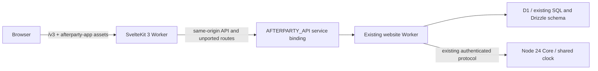

# SvelteKit listening-room candidate

This is the first working vertical slice of [issue #114](https://github.com/lukasvri/Afterparty-MusicBot/issues/114),
under `apps/web/`. It is an opt-in development candidate at `/v3`, not a production
cutover or a completed Afterparty 3.0 release. The existing website, Core, product
version and public patch notes remain the release baseline.

On 23 October 2026, the owner chose Classic as the basis for continued beta
development, with design improvements. The beta template now uses
`AFTERPARTY_BETA_ENTRY=0`: `/` serves Classic through the API service binding,
while `/v3` remains an optional prototype. This source change does not establish
the currently deployed beta version.

## Implemented journey

Create an unlisted private browser room, or join using its existing eight-character
code. Search the existing catalog API, add songs, inspect the shared queue, invite
friends and use host-only play, pause, next and seek controls. Audio uses the
official YouTube iframe API after an explicit local activation. A guest can add
music but cannot control the host's timeline. Leaving destroys local playback and
cancels polling and in-flight work while preserving saved ownership.

Rooms backed by Core receive live timeline updates through the existing event
stream. Each validated timeline has a maximum five-second lease. The interface
falls back to one-second authenticated polling when the stream is unavailable;
healthy streams retain ten-second reads for permissions and presence. Restoring
a connection reads current intent and never replays play, seek or next commands.

The interface uses the canonical vector logo and self-hosted Inter font directly
from `public/`, black surfaces, red controls, keyboard focus, touch targets and
reduced-motion support. Desktop and mobile use the same component tree. Styling
is a small CSS token system; the legacy Tailwind 4 stack is retained without
adding a second utility compiler to this slice.

## Architecture and compatibility



The locked candidate uses SvelteKit 3.1.0, Svelte 5.57.2, TypeScript 6.0.3,
Vite 8.3.5, adapter-cloudflare 8.0.1 and Wrangler 4.118.0. Their declared peer
ranges are compatible. TypeScript 7 is available but outside Kit's TypeScript 6
peer range. The existing website/Core TypeScript and Node 24 runtime are retained.
The candidate also retains the root project's patched Sharp and Undici overrides
for Wrangler/Miniflare's local development dependencies.
Kit 3 configuration lives in the Vite plugin, uses `#lib` package imports and
`$app/tsconfig`, and accesses bindings through `cloudflare:workers`.

The catch-all server endpoint forwards the original `Request` to a fixed service
binding and returns the original `Response`, including cookies, redirects and
unbuffered streams. No browser-controlled upstream URL, secrets, D1 connection or
new authentication namespace is introduced. OAuth callbacks and unported pages
remain handled by the existing Worker, with the public request URL, Origin,
HttpOnly cookies and authorization headers intact. Local templates contain no
production Worker/database identity. The new asset namespace avoids legacy assets.

Browser storage reuses the existing lazy preference/ownership migration helper.
Room mutations include the latest version and existing visitor/host headers.
Commands are serialized; a conflict refreshes state without replaying the command.
Late responses cannot cross a room switch or overwrite a newer timeline.
Read failures stop local audio; reconnecting only reads current intent and cannot
send recovery play/skip commands. Live updates use the existing protocol validator,
monotonic clock calibration and shared playback helpers. Stale/duplicate frames
cannot extend a lease, and retired Core epochs are fenced across both stream and
HTTP responses. Public stream payloads cannot grant permissions or overwrite
authenticated room presence. Expired timelines disable playback writes. Leaving
or changing rooms closes streams, clock samples, retry/watchdog timers and reads.
Search and radio-dependent next retain the existing 35-second catalog budget;
editing a query immediately cancels and retires its previous request.
Server/Core progression owns automatic next; delayed browser end events never
advance the shared queue. Discord rooms are explicitly rejected by this slice.

No schema, queue, authentication, persisted identifier, Discord isolation or Core
protocol migration is required. Existing D1/Drizzle access stays in the API Worker.
The built adapter proves the Worker target; local stack tests verify the binding
against real isolated D1 storage. Provider credentials and live Discord are excluded.

## Run locally

Use a clean cloud checkout with no production `.dev.vars`, credentials or data.
Node 24.17+, Python 3.11+ and FFmpeg are required for the whole repository.

```bash
npm run setup:cloud
npm run build
```

In a separate terminal, start only the website API with local synthetic storage:

```bash
XDG_CONFIG_HOME="$PWD/.sites-runtime/config" npm run start -- --name afterparty-api-local
```

Build and run the SvelteKit Worker in another terminal:

```bash
npm run build:web
npm --prefix apps/web run preview
```

Open `http://127.0.0.1:5174/v3`. The service binding discovers the API on port
8787 through the shared project-local registry. All Wrangler commands above are
local. For HMR, use `npm run dev:web`; its loopback API proxy preserves the public
Host/Origin relationship. Unported pages should be tested through the Worker
preview rather than the HMR server. Restart previews after rebuilding output.

## Validation

```bash
npm run check:all
npm --prefix apps/web run format:check
CHROMIUM_PATH=/usr/bin/chromium npm --prefix apps/web run test:browser
CHROMIUM_PATH=/usr/bin/chromium npm --prefix apps/web run test:stack
CHROMIUM_PATH=/usr/bin/chromium PREVIEW_URL=http://127.0.0.1:5174 npm run test:search
CHROMIUM_PATH=/usr/bin/chromium PREVIEW_URL=http://127.0.0.1:5174 npm run test:sync
```

`test:stack` requires both production builds but starts its own local Workers on
port 5175. It verifies Classic at the root without a redirect, the Classic bypass
and the optional `/v3` route. It applies
existing migrations and seeds fictional metadata into a fresh temporary D1
directory for every run, then exercises the actual API and
mobile UI without routing API responses in Playwright. It tests persistence,
wrong-room host tokens, guest restrictions, cross-origin rejection, stale revisions,
search and transport, and shuts down its own Workers and removes temporary data.
No remote D1 flags or provider keys are used. Without `CHROMIUM_PATH`, Playwright uses its installed
Chromium; CI installs the matching browser and runs the synthetic UI suite.

The normal full check now includes candidate type/a11y checks, Node contract tests
and the Cloudflare build. The existing Node 26 website CI job additionally checks
formatting, Classic search/synchronization, experimental desktop/mobile journeys
and the isolated D1 stack test. Each application
retains its own locked Wrangler version during local integration. The signed release packaging remains
unchanged and contains the existing website only. No deployment steps were added.

The browser suite also opens two isolated clients, desktop and mobile, against a
loopback HTTP fixture using native `EventSource`. It verifies immediate host/guest
updates, reduced room reads while the stream is fresh, Core epoch rollover,
polling fallback, failure recovery without unpausing and stream/poll cleanup.
This fixture supplies fictional API and event data; it is separate from the real
local Workers/D1 test and does not establish live provider or Discord audio.

See [screenshots and measurement provenance](assets/README.md). The candidate is
smaller in feature scope than Classic; payload observations must not be presented
as full-application performance parity. No audible Discord, live provider,
production OAuth, Lighthouse or field performance verification is claimed.

The recorded room/search payload observation from `768e6747` (before beta landing
configuration) is identical at 1440px and 390px:

| Successful local script responses | Classic | Svelte candidate |
| --- | ---: | ---: |
| Requests | 23 | 10 |
| Uncompressed bytes | 773,392 | 111,763 |
| Sum of individually gzipped bytes | 235,630 | 43,586 |

The candidate serves fewer features. These numbers are evidence for the scoped
slice only, not a measured whole-product speedup.

Local validation ran on Node 24.19.0, with an additional successful candidate
typecheck and Cloudflare production build on Node 26.12.1. Core was tested only
on Node 24 and its runtime configuration was not changed.

## Remaining work and rollout boundary

- Live subscriptions cover private browser-room timelines. Discord/concert stream
  consumption and their controls remain separate migration slices. D1-only rooms
  continue to work through polling when Core streaming is unavailable.
- Discord control, concerts, playlists/library, games, advanced room moderation,
  saved language choices and the three administration settings groups remain in
  Classic through existing links. These capabilities are not removed or ported.
- The reported radio discovery failure has no established reproduction in this
  task. Existing diagnostics and provider availability need a focused synthetic
  capture. This frontend migration does not claim to fix radio.
- Live YouTube embeds, browser autoplay behavior and source availability still need
  owner-approved acceptance outside cloud tests. Tests use a deterministic player
  boundary; they do not establish audible provider playback.

The owner-requested isolated beta has a dedicated
[deployment runbook](SVELTEKIT_BETA.md) and `apps/web/wrangler.beta.jsonc` template
for `ap.beta.openworks.no`, using the existing laptop beta and Afterparty test bot.
The beta entry flag is disabled in the template, keeping Classic at the root;
`/?classic=1` also bypasses older beta configurations that still select `/v3`.
These files prepare deployment and do not establish live availability.

A production rollout would bind the candidate to the existing API service
under the same public origin and validate the real OAuth callback, session cookies,
bindings, host state and legacy route/asset behavior. Keep `/` on the existing
application until feature and acceptance gates pass. A frontend rollback removes
candidate routing and serves the previous website artifact; D1 and Core require
no rollback migration because this slice changes neither schema nor protocol.
Do not delete databases or ownership storage. The beta request does not authorize
a production deployment, merge or automatic release changes.

No public release bullet or product version bump is appropriate for this opt-in
migration candidate. Its complete change and validation record belongs in the
draft PR, following [the release policy](RELEASING.md#notes-for-every-change).
